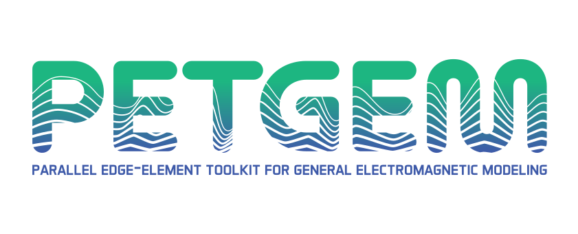
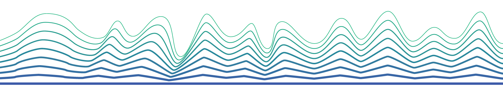

<p align="center">
  <picture>
    <source media="(prefers-color-scheme: dark)" srcset="docs/source/_static/brand/05_AF_PETGEM_Full_Logo_White.svg">
    
  </picture>
</p>

<p align="center">
  <a href="https://github.com/ocastilloreyes/petgem/actions/workflows/ci-develop.yml"></a>
  <a href="https://petgem.readthedocs.io/en/latest/index.html"></a>
  <a href="https://github.com/ocastilloreyes/petgem/blob/develop/LICENSE.rst"></a>
  <a href="https://github.com/ocastilloreyes/petgem/releases"></a>
  <a href="https://github.com/ocastilloreyes/petgem/pkgs/container/petgem-ci-env"></a>
</p>

<p align="center">
  <a href="https://petgem.readthedocs.io/en/latest/index.html"><b>Documentation</b></a> ·
  <a href="#quick-start"><b>Quick start</b></a> ·
  <a href="https://github.com/ocastilloreyes/petgem/tree/develop/examples"><b>Examples</b></a> ·
  <a href="#citing-petgem"><b>Citing</b></a>
</p>

<p align="center">
  
</p>

**PETGEM** (Parallel Edge-element Toolkit for General Electromagnetic Modeling)
is an open-source code for 3D electromagnetic modeling. It solves the CSEM
forward problem in the frequency and time domains, the MT forward problem and
the frequency-domain CSEM inverse problem. The electric field is discretized
with high-order Nédélec (edge) finite elements of polynomial order 1 to 6 on
unstructured tetrahedral meshes. **PETGEM** is written in C on top of
[PETSc](https://petsc.org/release/) and MPI. **PETGEM** is developed at the
[Universitat Politècnica de Catalunya (UPC)](https://www.ac.upc.edu/en?set_language=en)
and the [Barcelona Supercomputing Center (BSC)](https://www.bsc.es/es/discover-bsc/organisation/scientific-structure/geophysical-applications).

## Kernels

| Executable  | Problem                                                                 |
|-------------|-------------------------------------------------------------------------|
| `fm.csem`   | CSEM forward modeling (frequency domain)                                |
| `fm.tdcsem` | CSEM forward modeling (time domain)                                     |
| `fm.mt`     | MT forward modeling                                                     |
| `im.csem`   | CSEM inverse modeling (frequency domain, L-BFGS, adjoint-state gradients) |

A `petgem` dispatcher runs any of them. A small Python package in `utils/`
builds the HDF5 input files and reads the results.

## Dependencies

- [PETSc](https://petsc.org/) with **complex scalars**, MPI, MUMPS and HDF5, plus `petsc4py`
- [Gmsh](http://gmsh.info/)
- Python 3 with `numpy`, `h5py` and `meshio`; `matplotlib` for the example
  scripts, `pytest` for the tests

The Docker image built from `docker/Dockerfile` contains all of them.

## Quick start

```bash
git clone https://github.com/ocastilloreyes/petgem.git
cd petgem

docker pull ghcr.io/ocastilloreyes/petgem-ci-env:latest
docker tag ghcr.io/ocastilloreyes/petgem-ci-env:latest petgem-env
docker run --rm -it -u $(id -u):$(id -g) -v $(pwd):/workspace -w /workspace petgem-env bash

# inside the container
make
bash examples/fm_csem_marine/scripts/build_bundles.sh 1
(cd examples/fm_csem_marine && mpirun -n 4 ../../build/fm.csem -options_file configs/params.txt)
python3 examples/fm_csem_marine/scripts/postprocess.py
```

This runs the marine CSEM example and compares it with its reference. The
other cases are in `examples/`.

## Documentation

https://petgem.readthedocs.io/en/latest/index.html

## Citing PETGEM

If you use **PETGEM** for CSEM forward modeling in your research, please cite
the following publications:

- Castillo-Reyes, O., de la Puente, J., García-Castillo, L. E., & Cela, J. M.
  (2019). *Parallel 3-D marine controlled-source electromagnetic modeling using
  high-order tetrahedral Nédélec elements*. Geophysical Journal International,
  219(1), 39-65.
  [DOI: 10.1093/gji/ggz285](https://doi.org/10.1093/gji/ggz285)

- Castillo-Reyes, O., de la Puente, J., & Cela, J. M. (2018). *PETGEM: A
  parallel code for 3D CSEM forward modeling using edge finite elements*.
  Computers & Geosciences, 119, 123-136.
  [DOI: 10.1016/j.cageo.2018.07.005](https://doi.org/10.1016/j.cageo.2018.07.005)

If you use **PETGEM** for MT forward modeling in your research, please cite the
following publication:

- Castillo-Reyes, O., Modesto, D., Queralt, P., Marcuello, A., Ledo, J.,
  Amor-Martin, A., de la Puente, J., & García-Castillo, L. E. (2022).
  *3D magnetotelluric modeling using high-order tetrahedral Nédélec elements on
  massively parallel computing platforms*. Computers & Geosciences, 160,
  105030.
  [DOI: 10.1016/j.cageo.2021.105030](https://doi.org/10.1016/j.cageo.2021.105030)

Additional publications can be found in the documentation and on
[Google Scholar](https://scholar.google.es/citations?user=ifjbBssAAAAJ&hl=es&oi=ao).

## License

BSD 3-Clause. See [LICENSE.rst](LICENSE.rst).

<p align="center">
  
</p>
